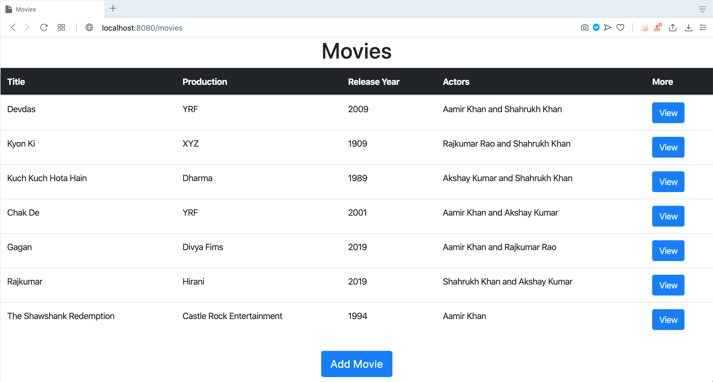
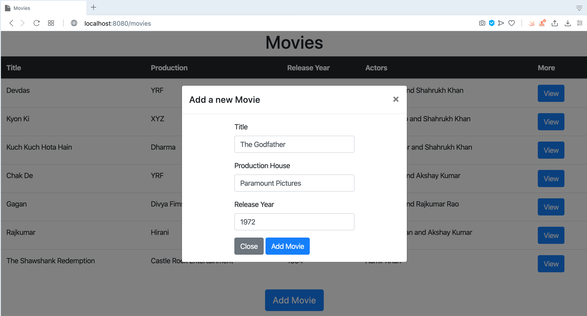
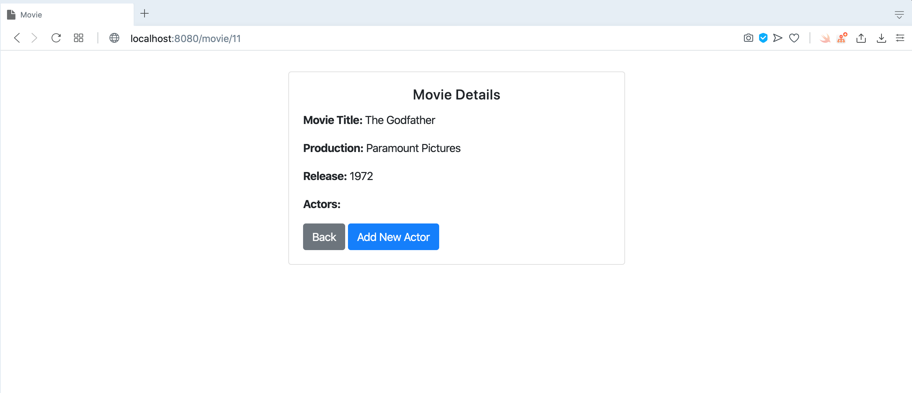
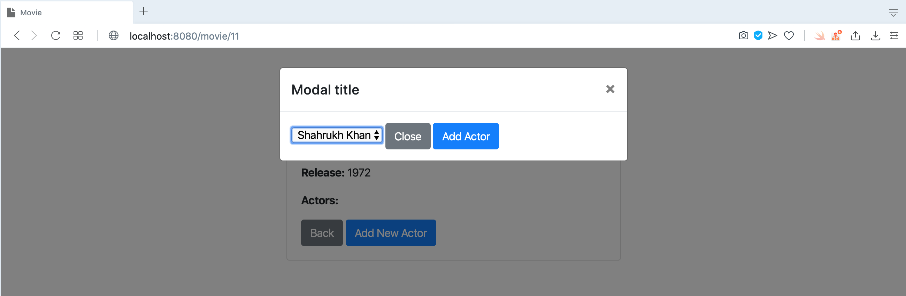
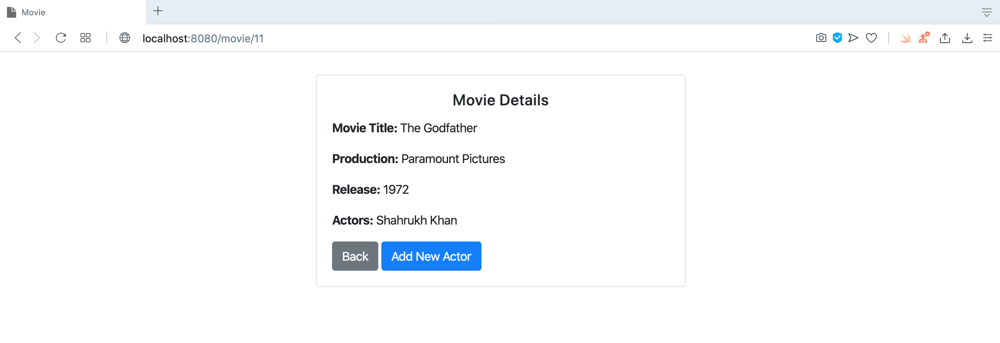

# Spring Boot Thymeleaf Movie App

[](https://github.com/hendisantika/spring-thymeleaf-movie-app/actions/workflows/maven.yml)


A simple movie catalogue built with Spring Boot, Spring Data JPA, Thymeleaf and an in-memory H2 database.
You can list movies, add new movies, and attach actors to a movie.

## Tech Stack

- Java 25
- Spring Boot 4.1.2 (Web MVC, Data JPA, Thymeleaf, DevTools)
- H2 in-memory database
- Lombok
- Maven

## Requirements

1. JDK 25 installed on your machine (e.g. via [SDKMAN!](https://sdkman.io/): `sdk install java 25-tem`)
2. Maven 3.9+ installed on your machine

## Getting Started

1. Clone this repository:
   ```shell
   git clone https://github.com/hendisantika/spring-thymeleaf-movie-app.git
   ```
2. Go to the folder:
   ```shell
   cd spring-thymeleaf-movie-app
   ```
3. Run the application:
   ```shell
   mvn clean spring-boot:run
   ```
4. Open your favorite browser: http://localhost:8080

### Build & Test

```shell
mvn clean verify
java -jar target/spring-thymeleaf-movie-app-0.0.1-SNAPSHOT.jar
```

## CI/CD & Dependency Management

- **GitHub Actions** (`.github/workflows/maven.yml`) builds and tests the project on Temurin JDK 25 for every push and pull request to `master`, and submits the Maven dependency graph to GitHub on pushes to `master`.
- **Dependabot** (`.github/dependabot.yml`) keeps dependencies up to date:
  - Maven: checked daily (05:00 Asia/Jakarta), with Spring, test, and other minor/patch updates grouped into single PRs.
  - GitHub Actions: checked weekly and grouped into a single PR.
  - PRs are labelled and use conventional commit prefixes (`chore(deps)`, `ci(deps)`).

## Images Screen shot

### List All the movies



### Add New Movie



### Add New Actor



### Add New Actor Pop Up



### View Movie Details


